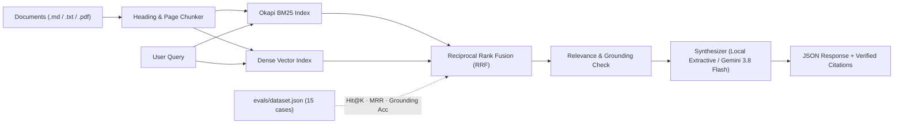

<div align="center">

# Hybrid-RAG Eval Service

**Production-structured Hybrid Search (BM25 + Dense Vector + RRF) Document Q&A API with Grounded Citations, Abstention Guardrails, and Automated Evals.**

[](https://github.com/YSinggg/hybrid-rag-eval/actions/workflows/ci.yml)
[](https://www.python.org/downloads/)
[](https://fastapi.tiangolo.com/)
[](https://docs.astral.sh/uv/)
[](https://docs.astral.sh/ruff/)
[](LICENSE)

</div>

---

## Table of Contents

- [Why This Project Exists](#why-this-project-exists)
- [Key Features](#key-features)
- [System Architecture](#system-architecture)
- [Evaluation Benchmark](#evaluation-benchmark)
- [Quickstart](#quickstart)
- [API Reference & Examples](#api-reference--examples)
- [Project Structure](#project-structure)
- [Engineering Roadmap](#engineering-roadmap)
- [License](#license)

---

## Why This Project Exists

Most starter RAG demos break in production for three predictable reasons:

1. **Vector-only search misses exact identifiers:** Queries with error codes (`ERR_RATE_429`, `ERR_DB_POOL_EXHAUSTED`) or severity labels (`SEV-1`) often fail under pure semantic embeddings.
2. **No automated evaluation:** Teams tweak chunk sizes or prompts blindly without measuring retrieval recall, ranking quality, or answer grounding.
3. **Silent hallucinations on out-of-scope questions:** When the corpus lacks an answer, naive pipelines still generate plausible-sounding guesses.

**Hybrid-RAG Eval Service** addresses all three with **BM25 + Vector Reciprocal Rank Fusion (RRF)**, **schema-enforced citations & abstention**, and a **reproducible benchmark suite** wired into CI.

---

## Key Features

- **Hybrid Retrieval with RRF:** Combines Okapi BM25 (with compound-identifier tokenization) and L2-normalized cosine vector search via Reciprocal Rank Fusion, plus per-query `bm25`, `vector`, and `hybrid` modes.
- **Heading- & Page-Aware Chunking:** Parses `.md`, `.txt`, and `.pdf` documents while preserving Markdown section headings and PDF page numbers for verifiable citations.
- **Zero-Key Offline Mode + Google Gemini Upgrade:** Runs 100% locally out of the box (`local-hashing-384d` + `local-extractive`) and switches seamlessly to **Google Gemini** (`gemini-embedding-001` + `gemini-3.8-flash` via the Interactions API with JSON schema `response_format`) when `GEMINI_API_KEY` is set.
- **Abstention Guardrails:** Refuses to answer out-of-scope questions (`grounded: false`, empty `citations`) rather than fabricating facts.
- **Automated Eval Harness & CI:** Benchmarks `Hit@K`, `MRR`, `Keyword Recall`, `Grounding Accuracy`, and `Latency` across retrieval modes on every push via GitHub Actions.
- **Interactive Web Playground & Docker Support:** Includes a built-in UI at `/` and Swagger docs at `/docs`.

---

## System Architecture



---

## Evaluation Benchmark

Measured across **15 curated test cases** in [`evals/dataset.json`](evals/dataset.json) (13 technical runbook/API/onboarding questions + 2 out-of-scope abstention tests) using the offline provider (`local-hashing-384d+local-extractive`):

| Mode | Hit@4 | MRR | Keyword Recall | Grounding Acc | Avg Latency (ms) |
|---|---:|---:|---:|---:|---:|
| `bm25` | 1.000 | 1.000 | 0.821 | 1.000 | 0.54 |
| `vector` | 1.000 | 0.962 | 0.718 | 0.933 | 0.52 |
| `hybrid` | 1.000 | 0.962 | 0.821 | 1.000 | 0.54 |

<details>
<summary>Metric Definitions</summary>

- **Hit@4:** Fraction of answerable queries where the expected source document appears in the top 4 retrieved chunks.
- **MRR (Mean Reciprocal Rank):** Average of `1 / rank` of the first matching source document.
- **Keyword Recall:** Fraction of expected factual terms present in the synthesized answer.
- **Grounding Acc:** Accuracy across both answerable queries (`grounded=true`) and unanswerable queries (`grounded=false`).

</details>

---

## Quickstart

### 1. Run Locally (Offline Mode — No API Key Required)

```bash
git clone https://github.com/YSinggg/hybrid-rag-eval.git
cd hybrid-rag-eval

# Install dependencies and editable package
uv sync

# Start the FastAPI server + web playground
uv run uvicorn hybrid_rag.api:app --reload
```

Open **`http://127.0.0.1:8000`** for the interactive playground or **`http://127.0.0.1:8000/docs`** for Swagger UI.

### 2. Run Lint, Tests & Benchmarks

```bash
uv run ruff check src tests evals
uv run pytest -v
uv run python evals/run_eval.py
```

### 3. Enable Google Gemini (`gemini-3.8-flash` + `gemini-embedding-001`)

```bash
cp .env.example .env
```

Set your Google AI Studio key inside `.env`:

```env
RAG_PROVIDER=auto
GEMINI_API_KEY=your_api_key_here
```

### 4. Run with Docker

```bash
docker build -t hybrid-rag-eval .
docker run -p 8000:8000 --env-file .env hybrid-rag-eval
```

---

## API Reference & Examples

| Method | Endpoint | Description |
|---|---|---|
| `GET` | `/` | Interactive HTML Q&A and upload playground |
| `GET` | `/health` | Service health check |
| `GET` | `/stats` | Indexed document/chunk counts and active provider |
| `POST` | `/ingest/text` | Chunk and index raw text or Markdown |
| `POST` | `/ingest/file` | Upload `.md`, `.txt`, or `.pdf` files |
| `POST` | `/query` | Run `hybrid`, `bm25`, or `vector` RAG query with citations |

### Example Query

```bash
curl -X POST http://127.0.0.1:8000/query \
  -H "Content-Type: application/json" \
  -d '{"question": "How should clients handle ERR_RATE_429?", "mode": "hybrid"}'
```

<details>
<summary>Sample JSON Response</summary>

```json
{
  "answer": "Clients should implement **exponential backoff with full jitter** starting at 500 ms and capped at 32 seconds, respecting `Retry-After` whenever present. [<doc_id>-c002]",
  "citations": [
    {
      "chunk_id": "<doc_id>-c002",
      "source": "api_rate_limits.md",
      "section": "3. Handling `ERR_RATE_429`",
      "page": null,
      "quote": "When a client exceeds its quota, the gateway returns HTTP `429 Too Many Requests`..."
    }
  ],
  "grounded": true,
  "provider": "local-hashing-384d+local-extractive",
  "mode": "hybrid",
  "latency_ms": 0.54
}
```

</details>

---

## Project Structure

```text
hybrid-rag-eval/
├── .github/workflows/ci.yml   # GitHub Actions: Ruff + Pytest + Eval suite
├── data/sample_docs/          # Sample engineering runbooks & guides
├── evals/
│   ├── dataset.json           # 15 Q&A + abstention evaluation cases
│   └── run_eval.py            # Automated retrieval & grounding benchmark
├── src/hybrid_rag/
│   ├── api.py                 # FastAPI endpoints + HTML playground
│   ├── chunking.py            # Section/page-aware overlapping chunker
│   ├── config.py              # Pydantic settings (.env support)
│   ├── models.py              # Request, response, chunk & citation schemas
│   ├── pipeline.py            # End-to-end RagPipeline orchestrator
│   ├── providers.py           # Offline & Google Gemini embedding/LLM backends
│   └── retriever.py           # BM25 + dense vector + RRF hybrid retriever
├── tests/                     # Unit & FastAPI integration tests
├── Dockerfile
├── LICENSE
└── pyproject.toml
```

---

## Engineering Roadmap

- [ ] Add persistent vector storage backend (Qdrant / `pgvector`) alongside in-memory mode
- [ ] Add optional cross-encoder reranking stage post-RRF and benchmark MRR impact
- [ ] Add LLM-as-a-Judge faithfulness scoring in `evals/run_eval.py` when `GEMINI_API_KEY` is active
- [ ] Add streaming SSE responses (`POST /query/stream`)

---

## License

Released under the [MIT License](LICENSE).
